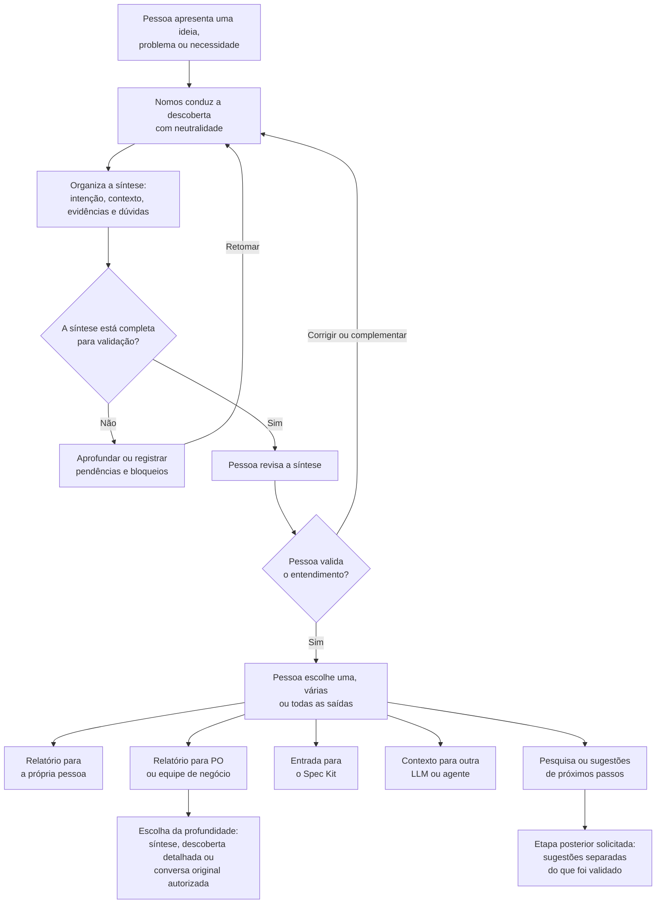

# Nomos Discovery

Nomos é uma metodologia de descoberta de necessidades, acompanhada de uma skill para agentes de inteligência artificial. Sua finalidade é ajudar uma pessoa a compreender e esclarecer sua intenção antes de decidir o que fazer, construir uma solução ou iniciar uma especificação.

Uma demanda pode chegar como uma ideia vaga ou como uma solução aparentemente definida: um relatório, uma automação, um sistema ou uma mudança de processo. Antes de transformar esse pedido em trabalho, o Nomos conduz uma conversa para compreender o contexto, as pessoas envolvidas, o resultado desejado e as dúvidas que ainda precisam ser esclarecidas.

A intenção não precisa nascer pronta. Ela pode ser descoberta e construída ao longo da conversa. O Nomos ajuda a organizar esse entendimento sem decidir pela pessoa, presumir que software é necessário ou conduzi-la para uma solução.

## Origem e justificativa do nome Nomos

O nome Nomos tem origem no grego antigo νόμος (nómos), termo associado a lei, norma, costume, ordem e princípios que organizam uma determinada realidade.

A escolha está relacionada à proposta central da metodologia: estabelecer clareza e estrutura para uma intenção antes que ela seja transformada em especificações e implementação.

O Nomos não pretende determinar o que deve ser construído. Sua função é organizar o processo de descoberta para que a intenção do solicitante seja compreendida, esclarecida e registrada sem que o agente imponha suas próprias decisões.

Durante a concepção da metodologia, foram explorados nomes inspirados no grego e no latim, buscando uma identidade que reunisse três características:

- **Significado conceitual:** representar uma metodologia fundamentada em princípios, e não apenas uma ferramenta de desenvolvimento.
- **Identidade própria:** possuir um nome curto, reconhecível e capaz de funcionar independentemente do GitHub Spec Kit.
- **Amplitude de aplicação:** não limitar a metodologia ao desenvolvimento de software, já que o Discovery pode revelar necessidades que não exigem uma solução tecnológica.

Entre as alternativas discutidas estavam Clarus, associado à clareza, e possibilidades derivadas do latim intentio, relacionadas à intenção. Embora Clarus tenha sido considerado interessante, nenhuma alternativa demonstrou superioridade suficiente para substituir Nomos.

É importante registrar que, no histórico disponível, Nomos permaneceu como nome de trabalho adotado, mas a discussão sobre a identidade definitiva não foi formalmente encerrada.

A relação entre o nome e a metodologia é conceitual, não uma tradução literal: nómos não significa descoberta ou intenção. O termo representa a ideia de princípios e estrutura que orientam o processo de descoberta.

## Princípios

- **Neutralidade durante a descoberta:** o agente facilita a reflexão sem impor, aprovar ou desestimular uma solução.
- **A pessoa decide:** suas escolhas, dúvidas e correções são preservadas; o agente não decide em seu lugar.
- **Evidências e incertezas distintas:** declarações, interpretações, hipóteses, conflitos e informações desconhecidas não são confundidos.
- **Validação antes das saídas:** a síntese é apresentada à pessoa e precisa estar completa e ser validada antes de escolher ou gerar as saídas.
- **Sem solução obrigatória:** a descoberta pode levar a uma ação não tecnológica, ao uso de algo existente, a mais investigação ou à preparação de software, conforme a decisão da pessoa.

A validação confirma que a síntese representa fielmente o entendimento alcançado. Ela não significa, por si só, aprovação de uma solução. Dúvidas podem ser registradas como abertas quando a pessoa concorda que permanecem sem resposta; uma lacuna ou contradição que impeça compreender a intenção deve ser esclarecida ou registrada como bloqueio.

## Fluxo pretendido

1. **Descobrir:** a pessoa apresenta uma ideia, problema ou necessidade; o Nomos conduz uma entrevista adaptativa e organiza o entendimento.
2. **Sintetizar e validar:** o agente apresenta a síntese para correção e confirmação. Se houver questões essenciais pendentes, a descoberta continua ou fica bloqueada.
3. **Escolher saídas:** depois de a síntese estar fechada e validada, a pessoa escolhe uma, várias ou todas as saídas disponíveis.
4. **Preparar as saídas:** o conteúdo é adaptado ao destinatário, preservando a síntese validada e distinguindo fatos de interpretações.

### Diagrama do fluxo pretendido

O diagrama ilustra a evolução em discussão; a skill publicada ainda não implementa todas as saídas.

## Saídas em estudo

A direção proposta é usar uma síntese de descoberta em Markdown, legível por pessoas e por outras LLMs, como base para diferentes destinos:

- **Relatório para a pessoa:** apresenta o entendimento alcançado, as dúvidas e as decisões registradas.
- **Relatório para PO ou equipe de negócio:** organiza contexto, necessidades e pontos que exigem atenção. A pessoa poderá escolher o nível de detalhe, da síntese ao registro da descoberta, incluindo a conversa original somente quando autorizar seu compartilhamento.
- **Entrada para GitHub Spec Kit:** prepara o contexto para uma etapa posterior de especificação, quando essa for a escolha apropriada.
- **Contexto para outra LLM ou agente:** transmite o resultado da descoberta para o próximo trabalho.
- **Pesquisa ou sugestões de próximos passos:** quando solicitado, uma LLM pode usar a descoberta validada para pesquisar ou sugerir alternativas em uma etapa posterior. Essas sugestões devem ser identificadas e separadas do que a pessoa declarou e validou.

Essas saídas descrevem a **evolução pretendida**, ainda em discussão; não representam funcionalidades já verificadas na skill publicada.

## Estado atual da skill

A versão original construída no projeto Nomos está em [`skills/nomos/SKILL.md`](skills/nomos/SKILL.md). Ela apresenta a metodologia e seu fluxo de discovery, com um contrato de saída atualmente voltado ao GitHub Spec Kit. A generalização das saídas e a revisão do núcleo da metodologia ainda serão trabalhadas.

O Nomos não é um fork do Spec Kit nem requer essa ferramenta para sua identidade metodológica. A skill publicada ainda precisa ser avaliada quanto à compatibilidade prática com diferentes agentes e ambientes. Este projeto não possui vínculo ou endosso do GitHub.
